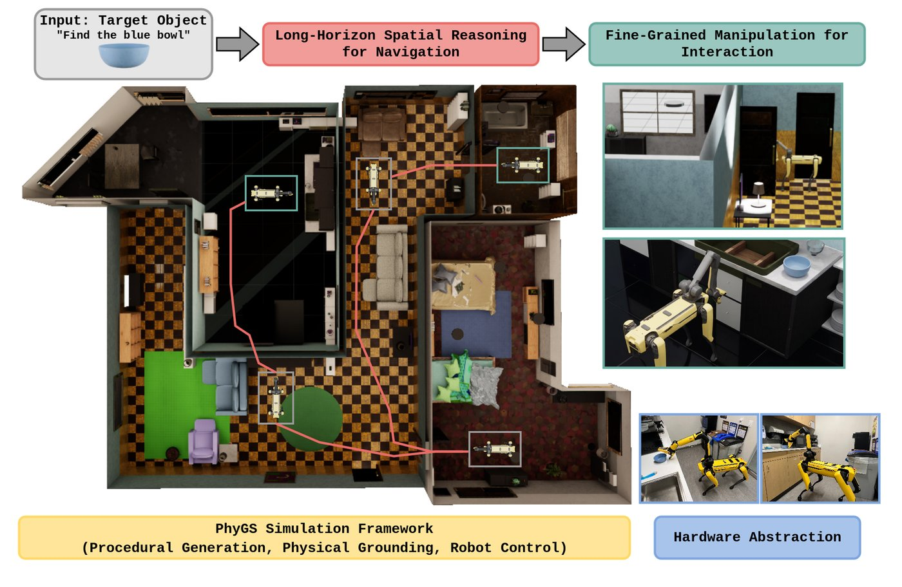
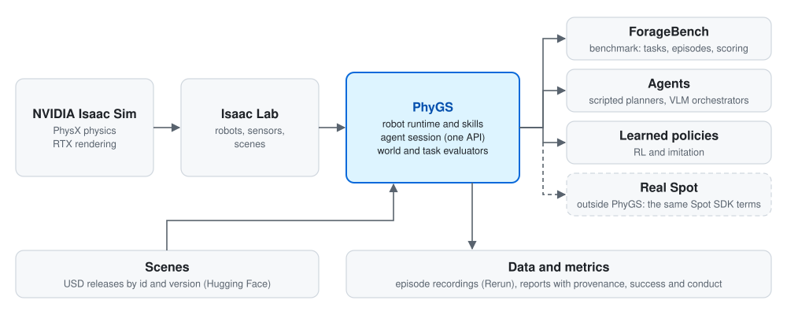

# ForageBench: can a robot find what you asked for and pick it up? A benchmark for interactive object search in photorealistic houses

> [!NOTE]
> This is the `develop` branch: the benchmark on PhyGS 0.12.0, with the three development episodes (manifest v0). The `main` branch is the May 2026 beta.

[](https://docs.isaacsim.omniverse.nvidia.com/6.2.0/index.html)
[](https://isaac-sim.github.io/IsaacLab/v3.0.0/)
[](https://docs.python.org/3/whatsnew/3.12.html)
[](https://releases.ubuntu.com/24.04/)
[](LICENSE)

[](https://m-and-m-lab.github.io/ForageBench/assets/papers/foragebench.pdf)
[](https://m-and-m-lab.github.io/ForageBench/)
[](https://github.com/m-and-m-lab/ForageBench/blob/develop/docs/README.md)
[](https://huggingface.co/datasets/mandmlabresearch/ForageBench)

[Aparajito Saha](https://aparajitosaha.github.io)<sup>1</sup>, [Zhen Hao Gan](https://ganzh6880.github.io)<sup>1</sup>, Jinjia Guo<sup>1</sup>, Jacob Skwirsk<sup>1</sup>, Jeremy Acheampong<sup>1</sup>, [Anton Arapin](https://anton-arapin.github.io)<sup>1</sup>, [Chahyon Ku](https://chahyon-ku.github.io)<sup>1</sup>, [Yue Hu](https://phyllish.github.io)<sup>1</sup>, [Nima Fazeli](https://www.mmintlab.com/people/nima-fazeli/)<sup>1</sup>, [Bernadette Bucher](https://bucherb.github.io)<sup>1</sup>
<br><sup>1</sup>[Mapping and Motion Lab](https://sites.google.com/umich.edu/mandmlab/), University of Michigan, Ann Arbor

**[🌐 Project page](https://m-and-m-lab.github.io/ForageBench/)** · **[📄 Paper](https://m-and-m-lab.github.io/ForageBench/assets/papers/foragebench.pdf)** · **[📚 Docs](https://github.com/m-and-m-lab/ForageBench/blob/develop/docs/README.md)** · **[🤗 Dataset](https://huggingface.co/datasets/mandmlabresearch/ForageBench)**

<p align="center"></p>

## 📦 Overview

ForageBench asks a mobile manipulator in a house to find an object it was told about in words, open what hides it, and bring it into its hand. It runs on [PhyGS](https://github.com/m-and-m-lab/PhyGS) with a simulated Boston Dynamics Spot with an arm, and scores every run from the physics. It is for people who build mobile-manipulation agents, such as vision-language models that pick a skill and point at its target in a camera image, and want to know why they fail: where they searched, what they chose, or what they pointed at.

**Why ForageBench**
- **Success is measured, not self-reported.** The target must end in the hand, the arm stowed and the robot upright, as the physics shows after the robot stops.
- **Conduct is reported beside success.** Arm contacts with their force, drawers left open and objects moved are listed, never folded into the score.
- **Ceilings are measured beside every model.** The oracle (the skills given the true targets) and the pointing oracle (the skills given perfect points in the images) show what the skills allow.
- **One agent API, shared with PhyGS.** An agent is a function `run(session)`; every call it makes is recorded and counted in the result.

<p align="center"><picture>
  <source media="(prefers-color-scheme: dark)" srcset="docs/figures/where_it_fits_dark.svg">
  
</picture></p>

## ✅ Requirements

| | Tested |
| --- | --- |
| PhyGS | 0.12.0 at commit 67fddf1, pinned as the submodule `third_party/phygs`; runs on another PhyGS are unpinned ([the pin](docs/install.md#the-phygs-pin)) |
| Container | PhyGS's: Isaac Sim 6.2.0, Isaac Lab 3.0.0, Python 3.12, ROS 2 Jazzy ([PhyGS requirements](https://github.com/m-and-m-lab/PhyGS/blob/develop/README.md#-requirements)) |
| GPU | NVIDIA RTX with RT cores; tested on a GeForce RTX 4090, 24 GB |

## 🛠️ Installation

In PhyGS's container ([PhyGS installation](https://github.com/m-and-m-lab/PhyGS/blob/develop/README.md#%EF%B8%8F-installation)), clone ForageBench with PhyGS at the pinned release and install both ([details](docs/install.md)):

```bash
cd /workspace/isaaclab/scripts
git clone --recursive -b develop https://github.com/m-and-m-lab/ForageBench.git   # --recursive: PhyGS and its Spot meshes
cd ForageBench
isaaclab -p -m pip install -e third_party/phygs --no-deps
isaaclab -p -m pip install -e . --no-deps
PYTEST_DISABLE_PLUGIN_AUTOLOAD=1 isaaclab -p -m pytest tests -q   # Unit tests, no simulator.
```

**Check it works.** `describe` says what a run would do, without the simulator; the null agent then observes once and finishes, which fails the task (about a minute):

```bash
cd /workspace/isaaclab
isaaclab -p -m foragebench describe --episode dev/grid_table --track privileged --agent null
FORAGEBENCH=scripts/ForageBench
isaaclab -p -m foragebench run --episode dev/grid_table --track privileged --agent null \
  --output $FORAGEBENCH/output_check/$(date +%Y%m%d-%H%M)_null
```

Expected output (paths shortened; `describe` prints more lines):

```
PhyGS      pinned 0.12.0 at 67fddf1, installed 0.12.0 at 67fddf1: pinned
scene      grid_storage, present: .../phygs/scene/builtin/grid_storage/scene.usda
task       retrieve: 'the small green box'
rules      version 3
...
dev/grid_table [privileged] null seed 0 completed: failure (not held), clean=True, ended by finish after 1.0 s; scripts/ForageBench/output_check/<YYYYMMDD-HHMM>_null/result.json
```

A `PhyGS` row ending in `unpinned (...)` says why the installed PhyGS is not the pinned release: runs still go ahead, but their results are not publishable ([the pin](docs/install.md#the-phygs-pin)).

## 🚀 Quick start

The oracle walks to the table, picks the small green box and stows the arm, then its video is rendered:

```bash
cd /workspace/isaaclab
OUT=scripts/ForageBench/output_check/$(date +%Y%m%d-%H%M)_oracle
isaaclab -p -m foragebench run --episode dev/grid_table --track privileged --agent oracle --output $OUT
isaaclab -p -m phygs replay $OUT   # The video: $OUT/replay/replay.mp4
```

## 📊 Leaderboard

Written from [`leaderboard/results.json`](leaderboard/results.json); [how to submit](docs/submitting.md). The development episodes bound what the skills can do; they say nothing about unseen houses ([task card](docs/task_card.md)).

<!-- leaderboard: written by `foragebench leaderboard readme` from leaderboard/results.json -->
| Agent | Track | Set | n | Success | Wilson 95% | Clean successes | Per episode (successes/runs) | PhyGS | Rules | Date |
| --- | --- | --- | --- | --- | --- | --- | --- | --- | --- | --- |
| oracle | `privileged` | dev | 15 | 15/15 | 0.80–1.00 | 5/15 | `grid_drawer` 5/5, `grid_table` 5/5, `house_drawer` 5/5 | 0.12.0 | 3 | 2026-11-08 |
| null | `privileged` | dev | 15 | 0/15 | 0.00–0.20 | 0/15 | `grid_drawer` 0/5, `grid_table` 0/5, `house_drawer` 0/5 | 0.12.0 | 3 | 2026-11-08 |
<!-- /leaderboard -->

## 🧭 Where to go next

| I want to… | Read |
| --- | --- |
| write an agent, or plug in a vision-language model | [foragebench/agents/](foragebench/agents/README.md) |
| know what an agent may do and is told (tracks) | [foragebench/tracks/](foragebench/tracks/README.md) |
| read or add episodes | [foragebench/episodes/](foragebench/episodes/README.md) |
| understand the task and its task evaluator | [docs/task_card.md](docs/task_card.md) · [foragebench/tasks/](foragebench/tasks/README.md) |
| run suites and read the metrics | [foragebench/eval/](foragebench/eval/README.md) |
| submit results | [docs/submitting.md](docs/submitting.md) |
| browse the docs, or see what changed | [docs/README.md](docs/README.md) · [CHANGELOG.md](CHANGELOG.md) |
| contribute (people and coding agents), or report a bug | [AGENTS.md](AGENTS.md) · [GitHub issues](https://github.com/m-and-m-lab/ForageBench/issues) |

## 🗂️ Repository layout

| Path | Purpose | Docs |
| --- | --- | --- |
| `foragebench/` | The benchmark: tasks, episodes, tracks, agents, scenes, eval (the `foragebench` command) | [docs](docs/README.md) |
| `configs/` | The rules: the PhyGS pin, the backends, the end-of-episode settings | [task card](docs/task_card.md) |
| `leaderboard/` | `results.json`, the baselines the leaderboard is written from | [submitting](docs/submitting.md) |
| `tests/` | Unit tests with a fake ground truth, and the import guards | — |
| `third_party/` | PhyGS, pinned to a release | [README](third_party/README.md) |
| `.github/` | The check that the PhyGS pin is a tagged release | — |
| `docs/` | Task card, installation, submitting, figures | [README](docs/README.md) |
| `assets/` | The teaser image | — |

## 🧱 Scenes and data

The grid episodes use a scene built into PhyGS. The house episode (`dev/house_drawer`) uses the house scene, release 1.3.0, from the scene dataset [`mandmlabresearch/ForageBench`](https://huggingface.co/datasets/mandmlabresearch/ForageBench) on Hugging Face: published at dataset commit `bfe0bb4`, 3.7 GB, private for now, licence to be announced. Fetching it: [foragebench/scenes/](foragebench/scenes/README.md).

## 📝 Citation

```bibtex
@misc{saha2026foragebench,
  title  = {ForageBench: A Photorealistic, Physically Grounded Benchmark for Interactive Object Search},
  author = {Saha, Aparajito and Gan, Zhen Hao and Guo, Jinjia and
            Skwirsk, Jacob and Acheampong, Jeremy and Arapin, Anton and
            Ku, Chahyon and Hu, Yue and Fazeli, Nima and Bucher, Bernadette},
  year   = {2026}
}
```

## ⚖️ License and acknowledgments

The licence is to be announced ([LICENSE](LICENSE)). Isaac Sim is proprietary NVIDIA software under its own licence terms.

ForageBench builds on [PhyGS](https://github.com/m-and-m-lab/PhyGS) and, through it, on [Isaac Sim](https://developer.nvidia.com/isaac/sim), [Isaac Lab](https://github.com/isaac-sim/IsaacLab), [Infinigen-Indoors](https://github.com/princeton-vl/infinigen), [Objaverse-XL](https://objaverse.allenai.org/), [cuRobo](https://curobo.org/), [Nav2](https://nav2.org/), [explore_lite](https://github.com/robo-friends/m-explore-ros2) and [MoveIt 2](https://moveit.picknik.ai/); please refer to each project's licence and cite it as its authors ask.
