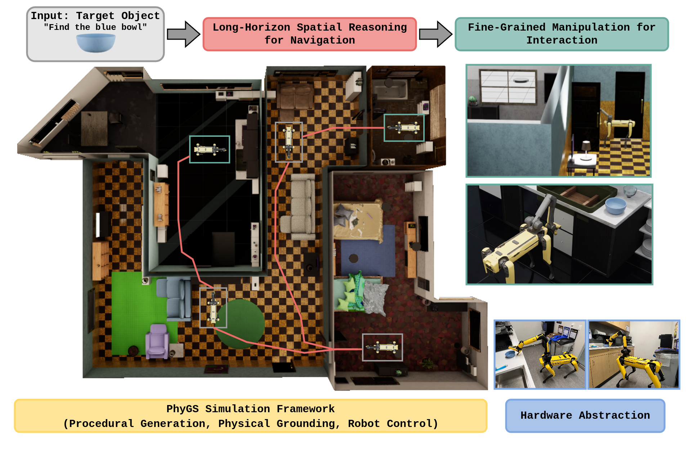

# ForageBench: A Photorealistic, Physically Grounded Benchmark for Interactive Object Search

[](https://m-and-m-lab.github.io/ForageBench/assets/papers/foragebench.pdf)
[](https://m-and-m-lab.github.io/ForageBench/)
[](https://developer.nvidia.com/isaac/sim)
[](LICENSE)

[Aparajito Saha](https://aparajitosaha.github.io)<sup>1</sup>, [Zhen Hao Gan](https://ganzh6880.github.io)<sup>1</sup>, Jinjia Guo<sup>1</sup>, Jacob Skwirsk<sup>1</sup>, Jeremy Acheampong<sup>1</sup>, [Anton Arapin](https://anton-arapin.github.io)<sup>1</sup>, [Chahyon Ku](https://chahyon-ku.github.io)<sup>1</sup>, [Yue Hu](https://phyllish.github.io)<sup>1</sup>, [Nima Fazeli](https://www.mmintlab.com/people/nima-fazeli/)<sup>1</sup>, [Bernadette Bucher](https://bucherb.github.io)<sup>1</sup>

<sup>1</sup>University of Michigan, Ann Arbor

**[Project page](https://m-and-m-lab.github.io/ForageBench)** &nbsp;·&nbsp; **[Paper](https://m-and-m-lab.github.io/ForageBench/assets/papers/foragebench.pdf)**

ForageBench is a benchmark for interactive object search: a mobile manipulator in a house has to find an object it was told about in words, open what hides it, and bring it into its hand. The robot is a simulated Boston Dynamics Spot with Arm; the houses are photorealistic, physically grounded scenes; nothing is faked on the way (no attached grasps, physical drawers, a legged base). ForageBench says what is asked and how it is scored. The simulation framework it runs on, [PhyGS](https://github.com/m-and-m-lab/PhyGS), is a git submodule of this repository, pinned to a release, so one recursive clone is the whole installation.

<p align="center">
  
</p>

## 📄 Abstract

Interactive semantic object search is the task of locating and retrieving a target object in an unseen, house-scale environment. This task requires both long-horizon spatial reasoning for navigation and fine-grained skills for manipulation, often demanding that an agent physically interact with the environment to make an occluded target perceivable. Prior benchmarks have largely isolated one capability or the other; we present ForageBench, a benchmark designed to study them jointly on a mobile manipulator developed in our newly introduced simulation framework PhyGS. PhyGS integrates large-scale procedural scene generation with photorealism, physical grounding, and low-level robotic control. Using PhyGS, we build an evaluation dataset of 25 house-scale scenes and 100 episodes spanning a progression of difficulty, and benchmark state-of-the-art vision-language models acting as high-level skill orchestrators. Our best baseline on a simulated Boston Dynamics Spot with Arm achieves an interactive search success of 4\%. PhyGS provides a hardware-abstracted interface mirroring Spot's SDK for development transfer between and simulation and the physical robot.

## ⚠️ Note on usage

ForageBench is under active development at the [Mapping and Motion Lab](https://sites.google.com/umich.edu/mandmlab/), and this version of the repository is a beta release intended for early community testing and usage. Please file a GitHub issue detailing any bugs faced or major feature requests, and the team will respond to and resolve these issues as soon as possible.

The `main` branch is the May 2026 beta. The `develop` branch is the benchmark described below, on PhyGS 0.3.2: the retrieve task with a physical evaluator, tracks, Nav2 navigation, cuRobo or MoveIt arm planning, 250 Hz physics. The episode set in this branch is the three development episodes (manifest v0); the 25-scene, 100-episode set and the hidden test split follow with manifest v1.

## 🎯 What ForageBench measures

**The task: retrieve.** The agent is told what to find ("the small green box"), never where. It succeeds when, at the end of the episode, the target is in its hand (measured, not assumed), the arm is stowed, the robot is upright and the budget was not exceeded. Nothing else counts: not standing next to the target, not a skill's "succeeded". **Conduct** is reported beside success, never folded into it: unintended arm contacts with their peak force, drawers left open; a run is `clean` when it has none. Also reported: SPL and SPL-M, skill execution success, the path walked, the time used. Everything is read from PhyGS's ground truth once, after the robot has stopped and settled. Details: [tasks/](foragebench/tasks/README.md), [eval/](foragebench/eval/README.md), the [task card](docs/task_card.md) for what is and is not claimed.

## 📦 What's in this repository

Each folder has its own README; start there.

1. [`foragebench/tasks/`](foragebench/tasks/README.md) — the retrieve task: brief, evaluator, thresholds, and what success and conduct mean.
2. [`foragebench/episodes/`](foragebench/episodes/README.md) — the episode files (scene release, start, target, budget, difficulty tier, optimal path), the schema, the tiers, the manifest of sets.
3. [`foragebench/tracks/`](foragebench/tracks/README.md) — what an agent may do and is told: `privileged`, `gt_localization`, `onboard` (planned).
4. [`foragebench/agents/`](foragebench/agents/README.md) — how to write an agent; the reference agents `null`, `template`, `oracle`, `vlm` (the model harness with its skill list).
5. [`foragebench/scenes/`](foragebench/scenes/README.md) — which scenes the episodes need and how to get them from the scene dataset.
6. [`foragebench/eval/`](foragebench/eval/README.md) — `run.py`, `suite.py`, `results.py`; `result.json` and the metrics.
7. `configs/benchmark_v1.yaml` — the rules: the PhyGS version pin, the backends, the end-of-episode settings, the SPL-M cost.
8. `tests/` — unit tests with a fake ground truth and the import guards; `docs/` — task card, install guide, design record, research notes; `third_party/phygs` — PhyGS, pinned.

## 🛠️ Installation

1. Build and enter PhyGS's Isaac Lab container and install ROS 2 Jazzy with Nav2 in it: [PhyGS installation](https://github.com/m-and-m-lab/PhyGS/blob/develop/README.md#%EF%B8%8F-installation). Nothing is repeated here.
2. Clone ForageBench with its submodules into the Isaac Lab `scripts` folder and install both packages:

```bash
cd /workspace/isaaclab/scripts
git clone --recursive -b develop https://github.com/m-and-m-lab/ForageBench.git   # --recursive: PhyGS and its Spot meshes
cd ForageBench && make install && make test
```

3. In every shell: `source /opt/explore_ws/install/setup.bash`, `export ROS_DOMAIN_ID=48`, `export FORAGEBENCH=scripts/ForageBench` (relative to the Isaac Lab root, where every command below runs).
4. Scenes: `./isaaclab.sh -p -m foragebench.scenes list` says which releases the episodes need; `fetch` gets the missing ones (the dataset is private for now; `hf auth login` first). The grid episodes need no download. Details: [docs/install.md](docs/install.md).

## 🚀 Quick start

```bash
cd /workspace/isaaclab
# The floor: the null agent observes once and finishes. Prints the scored result; ~1 minute.
./isaaclab.sh -p $FORAGEBENCH/foragebench/eval/run.py --episode dev/grid_table --track privileged --agent null \
  --output $FORAGEBENCH/output_check/$(date +%Y%m%d-%H%M)_grid_table_null

# The ceiling: the oracle retrieves the box (success, clean; ~65 simulated seconds).
./isaaclab.sh -p $FORAGEBENCH/foragebench/eval/run.py --episode dev/grid_table --track privileged --agent oracle \
  --output $FORAGEBENCH/output_check/$(date +%Y%m%d-%H%M)_grid_table_oracle

# The dev set, five repeats each, one simulator process per run; prints the summary table.
./isaaclab.sh -p $FORAGEBENCH/foragebench/eval/suite.py --set dev --track privileged --agent oracle --repeats 5 \
  --output $FORAGEBENCH/output_check/$(date +%Y%m%d-%H%M)_dev_oracle
```

## ✍️ Writing an agent

An agent is a function `run(session)`; the session is the only object it needs ([PhyGS's agent contract](https://github.com/m-and-m-lab/PhyGS/blob/develop/README.md#-the-agent-contract)):

```python
def run(session):
    brief = session.task.description                        # "the small green box": what, never where.
    packet = session.observe()                              # Calibrated RGB-D, joints, localization (as the track grants).
    session.wait(session.navigation.navigate_to(x=1.0, y=0.0, heading=0.0))   # Time passes only while the agent waits.
    session.wait(session.manipulation.move_to_pose(pose))   # Planned by cuRobo or MoveIt; feedback says why it failed.
    session.wait(session.manipulation.close_gripper())
    session.wait(session.manipulation.stow())
    session.finish("done")                                  # Then the framework stops everything, keeps the grip, evaluates.
```

Start from `template.py`, read `oracle.py` for a complete retrieve, run yours with `--agent path/to/agent.py:run`, or plug a vision-language model into the `vlm` harness: [agents/README.md](foragebench/agents/README.md).

## 📊 Baselines (dev set, 2026-10-28, PhyGS 0.3.1)

| Agent | Track | Runs | Success | Clean | Skill exec. | Sim s | Note |
| --- | --- | --- | --- | --- | --- | --- | --- |
| oracle | privileged | 15 (3 episodes × 5 seeds) | 15/15 (Wilson 95%: 0.80–1.00) | 5/15 | 0.90 | 107 | The noise floor of the skills. `grid_table` is clean every time; the drawer episodes succeed every time but leave the drawer open and touch the unit (peak 5–119 N), because the plan does not close it. |
| null | privileged | 2 | 0/2 | — | — | 1 | The floor. |

Per episode (oracle): `grid_table` 5/5 in 62–73 s; `grid_drawer` 5/5 in 111–149 s; `house_drawer` 5/5 in 121–137 s. SPL is not reported for the dev episodes: no optimal path lengths until the episode generator states them. The model baselines (`vlm` with Qwen3-VL and Gemini Robotics-ER on `gt_localization`) are next ([PLANS.md](PLANS.md)).

## 📤 Submitting results

Send the suite's `summary.json` and the per-run `result.json` files, from clean checkouts (`unpinned` 0: both `provenance.foragebench.dirty` and `provenance.code.dirty` false) with `phygs_version` equal to the pinned one. We rerun a sample of episodes with your agent before listing a result.

## 📚 Documentation

[docs/README.md](docs/README.md): the [task card](docs/task_card.md), [installation](docs/install.md), the design record (framework/benchmark split, benchmark audit, positioning against 40+ benchmarks) and the research notes behind them. Changes: [CHANGELOG.md](CHANGELOG.md). Status and plans: [PLANS.md](PLANS.md). Rules for contributors and coding agents, including the submodule rules: [AGENTS.md](AGENTS.md).

## 📝 Citation

If you use ForageBench in your research, please cite:

```bibtex
@misc{2026foragebench,
  title     = {ForageBench: A Photorealistic, Physically Grounded Benchmark for Interactive Object Search},
  author    = {Saha, Aparajito and Gan, Zhen Hao and Guo, Jinjia and
               Skwirsk, Jacob and Acheampong, Jeremy and Arapin, Anton and
               Ku, Chahyon and Hu, Yue and Fazeli, Nima and Bucher, Bernadette},
  year      = {2026}
}
```

## 🙏 Acknowledgments

ForageBench builds on [PhyGS](https://github.com/m-and-m-lab/PhyGS) and, through it, on
[Infinigen / Infinigen-Indoors](https://github.com/princeton-vl/infinigen),
[NVIDIA IsaacSim](https://developer.nvidia.com/isaac/sim),
[IsaacLab](https://github.com/isaac-sim/IsaacLab),
[Objaverse-XL](https://objaverse.allenai.org/),
[cuRobo](https://curobo.org/),
[Nav2](https://nav2.org/),
[explore_lite (m-explore-ros2)](https://github.com/robo-friends/m-explore-ros2) and
[MoveIt 2](https://moveit.picknik.ai/).

We thank the authors and maintainers of these tools. Please refer to each project's license and cite them as appropriate.
